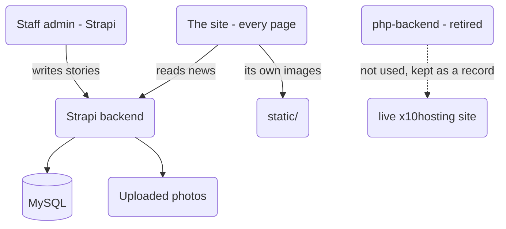

# SOFTNET Information Technology Center — website

One website, one process, one place for the news.

| Folder | What it is | Where it runs |
|---|---|---|
| `app/` + `nuxt.config.ts` | **Everything a visitor sees** — home, about, contact and news | built to `.output/`, served by **Node** |
| `static/` | The site's own images (`_sitc/images/…`) | published with the site |
| `php-backend/` | **The retired PHP backend** — the old JSON API, the old admin panel, old uploads | **nothing** — kept for the live x10hosting site while it is still on PHP |
| `tests/` | PHP checks for that retired backend | run by hand, on a machine with PHP |

The news and the admin now live in a **Strapi** backend, in its own folder outside this
project (`Documents\strapi`).

### Who owns what



- **The site is one program.** Nuxt answers every address, including the news pages, and it
  is the only thing a visitor ever talks to.
- **The news is data, not pages.** Strapi answers `/api/news`; the site reads it. A story
  posted a minute ago is on the site immediately — nothing is rebuilt or uploaded.
- **The admin is Strapi's own.** The old PHP admin screens are not used any more.

---

## 1. Running it on this PC

Two programs, in this order:

```powershell
# 1. the database (Laragon → Start All, so MySQL is running)

# 2. the news backend
cd 'C:\Users\MAITA GOINGCO\Documents\strapi'
npm run develop            # the admin is then at http://localhost:1337/admin

# 3. this site
cd 'C:\Users\MAITA GOINGCO\Documents\school1'
npm install
npm run dev                # http://localhost:3000
```

`npm run dev` is for working on the site. To run the finished thing the way a host does:

```powershell
npm run build              # writes .output/server and .output/public
npm start                  # serves it on http://localhost:3000
```

`.env` holds the two settings that point this copy at the backend on this PC. It is **not**
used on a real host — there they come from the host's own environment (see §5).

### The news backend must be running

Every news page asks Strapi for its story on the server. If Strapi is not running, those pages
say plainly that the news service could not be reached and answer **503** — they never pretend
the story does not exist. The home page quietly hides its news section and logs why.

---

## 2. How a news page works

This is the part worth understanding, because it is why the site needs Node at all.

**Facebook, Messenger, WhatsApp and Google do not run JavaScript.** They read the HTML the
server sends and build the preview card from the tags in `<head>`. A story's real title and
cover photo live in a database, so they have to be written into the page *before* it leaves the
server.

That used to be done by one PHP file (`public/news-view.php`), and it was the only reason PHP
was still on the site. Now the page is built by the server on every request, so
**`app/pages/news/[slug].vue` writes those tags itself** — and nothing else is needed.

One address, one design, always fresh:

- **the visitor gets a real story, in the site's own design**, drawn from the news API;
- **a crawler or a chat app gets the real title, summary and photo** in the HTML itself;
- **nothing is baked into a file**, so a story corrected in the admin shows the correction on
  the next visit.

The list works the same way: `/news` and `/news/page/2` are read from the news API **on the
server** (`app/components/NewsBrowser.vue`), so Google and a reader with JavaScript switched
off see a real list of stories rather than an empty shell.

### Addresses

| Address | What it is |
|---|---|
| `/news` | The list: lead story, grid, tag filter, search, paging |
| `/news/page/2` | Page 2 — a real address of its own, with its own canonical link |
| `/news/sports-day` | One story: cover photo, tags, body, photo gallery, share row |
| `/news/12` | The **old** numeric address — still opens the right story |

The newest story becomes a large lead card, and every card carries its tag chips and a Facebook
share button.

### Why there is no “3 photos” problem any more

Search and tag filtering happen in the browser against the same API (they are things a reader
does, and they must not need a round trip). Paging stays real links while no filter is on, so a
crawler can walk the whole archive.

### The story body

Strapi's editor stores a story as blocks (a paragraph, a heading, a list, a quote, a picture).
`app/utils/news-api.ts` turns them into HTML and **escapes every piece of text as it does**, so
a story can never bring a script into the page. That check is what makes `v-html` safe in
`[slug].vue`.

Pictures inside a story body are made **absolute against the news host**, because that HTML is
printed exactly as it is — nothing is left to add the host afterwards, and the uploads live on
the news host, not here.

---

## 3. The news data (`app/utils/news-api.ts`)

The pages were written when the PHP backend answered them in one particular shape: a list with
`news`, `total`, `pages` and a ready-made tag row; a story with `date_formatted`, `content` as
HTML and a `gallery`. Strapi speaks a different language — `data`, `meta.pagination`, blocks,
media objects.

**That translation lives in one file.** Every page still reads the old shape, so no page had to
learn a second one — and this file is the only place that knows Strapi exists.

It also decides what a failure *is*:

- **no such story** → the page answers **404**, says so, and is marked `noindex`;
- **the news API is unreachable or unset** → the page answers **503** and says so;
- **there is no news yet** → a normal empty page.

The difference matters: a broken backend must never be published to Google as “this page does
not exist”, and it must never make a visitor think the school has posted nothing.

### Slow-answering backend: retries

`app/utils/news-fetch.ts` retries every news request, and after that asks the same file over
plain `http` (measurements on the old host showed https hanging on one try in six while http
answered every time). **On the server the patience is shorter** — two tries at five seconds —
because a page is now rendered when it is asked for, and a reader should not be held at a blank
tab by a backend that is really down. In the browser the longer patience is kept.

If every try fails, the failure is reported. Nothing is ever invented to fill a gap.

---

## 4. Two settings, one place

```powershell
# local, in .env
NUXT_PUBLIC_NEWS_API_URL=http://localhost:1337   # where the news is read from
NUXT_PUBLIC_SITE_URL=http://localhost:3000       # where THIS site answers
```

Both are read through `app/composables/useNewsApi.ts`, so the home page section, the news list
and the story page can never disagree about which host holds the news.

They are **two different things and must not be confused**:

| Setting | What it is | What breaks if it is wrong |
|---|---|---|
| `NUXT_PUBLIC_NEWS_API_URL` | the Strapi backend | no news at all; every news page answers 503 |
| `NUXT_PUBLIC_SITE_URL` | where the site answers | every shared story and every canonical link points at the wrong address |

`NUXT_SITE_URL` / `NUXT_NEWS_API` (without `NUXT_PUBLIC_`) also work — they are read when the
site is **built**, and are baked in. On a host prefer the `NUXT_PUBLIC_` pair: those are read
when it **runs**, so changing an address needs a restart, not a new build.

`app/utils/site.js` holds a fallback for both, and the news one is **deliberately empty** — an
empty value makes the news pages say they are not configured, while a wrong one would quietly
show nothing, or point a live site at somebody's laptop.

---

## 5. Putting it on a real host

What the site needs now: **Node 20 or newer**, and nothing else. (No PHP — that is the point of
the change.)

```bash
npm ci
npm run build
NUXT_PUBLIC_NEWS_API_URL="https://news.example" NUXT_PUBLIC_SITE_URL="https://example.com" npm start
```

It listens on port 3000 by default; `PORT` or `NUXT_PORT` changes that.

`nginx.conf` in this folder is the front door: it passes everything to the app and keeps the
two `Host` / `X-Forwarded-Proto` headers, which the app needs to know the address the **reader**
used — that address is what goes into every share card.

**Two things to do on any host:**

1. **Run `npm start` under a supervisor** (`pm2`, `systemd`, or the host's own process manager),
   so the site comes back after a restart.
2. **Point Strapi at a public address too** (or run both on the same machine). A site on the
   internet cannot read news from a laptop, and Strapi needs MySQL it can reach.

⚠️ **What is not in this project yet:** the `x10hosting` live site is still on the old PHP
upload. Moving the domain is the last step, and it cannot be undone in a minute. Until it is
done, `php-backend/` stays in this project as the record of what is live there.

---

## 6. The retired PHP backend (`php-backend/`)

Left in the project on purpose, **not published with the site**, while the live site at
`sitci.x10.mx` still runs on PHP. It holds:

- `api/news.php`, `api/news-item.php` — the old JSON feeds;
- `admin/` — the old staff screens;
- `includes/news-head.php`, `news-view.php`, `news-redirect.php` — the old share-tag pages;
- `uploads/news/` — where the old photos were stored;
- `assets/`, `storage/`, `config.php`.

**It is not part of the site any more.** Two things make that true:

- `nuxt.config.ts` sets `dir.public` to `static/`, so the built site is `static/` + the build
  output and **nothing else**. Before this change the PHP folder was the site's public folder,
  so every build copied the API, the admin screens and `config.php` into the published site.
- `static/_sitc/images/` is a copy of the images that used to live under `public/_sitc/`. The
  pages read them from this site, which is why they had to leave the PHP folder.

**When the move is finished and the live site is confirmed working, `php-backend/` can be
deleted** — along with `tests/`, which only tests it. Nothing in `app/` reads either. Take a
copy of `php-backend/uploads/` first if the photos have not been carried into Strapi.

⚠️ **One thing it can no longer do locally.** `news-view.php` used to take the page it served
from `.output/public/200.html` — a shell the old *static* build wrote. The site is no longer
built that way (it is a Node app now), so there is no `200.html` in `.output/` any more, and
that one PHP page cannot be previewed on this PC. **The live x10hosting site is unaffected**: it
has its own uploaded copy of the shell next to it, and nothing here has changed it.

`tests/*.php` still run against `php-backend/` and are worth running before deleting it, so the
record is a working one.

---

## 7. Security notes (for whoever maintains this next)

- **Never publish the PHP folder again.** `dir.public` must stay `static/`. If it were changed
  back to `php-backend`, a build would ship `config.php` (the database credentials) to the new
  host.
- **The story body is escaped where it is turned into HTML** (`blocksToHtml` in
  `app/utils/news-api.ts`). A story's text is never trusted: the block types are a fixed list,
  every piece of text is escaped, and only real `http(s)` addresses become links. At the moment
  the ready-made HTML reaches `v-html`, that escaping is the only thing standing between a
  story and a script running for every visitor.
- **The news API is read, never trusted.** A reply that is not the shape expected produces an
  empty list or a stated failure, never HTML of its own.
- **Failures are stated, never faked.** 404 for a story that is not there, 503 when the news
  backend cannot be answered, and never a page that quietly shows nothing.
- **No secrets in this project.** Strapi's database password lives in the Strapi folder's own
  `.env`, and the site holds no credentials at all.
- In `php-backend/` (if it is ever run again): every query is a prepared statement, CSRF tokens
  on every POST, `password_hash` for passwords, uploads checked by real file content and
  renamed, and `storage/` blocked from the web. See its own comments.

---

## 8. Known loose ends

- **Nothing on the live site has changed yet.** This project is ready to move; the domain has
  not moved. That is deliberate — see §5.
- **Content is empty.** No stories have been imported; the site will look empty until someone
  adds them in the Strapi admin. Photos that were in `php-backend/uploads/news/` have not been
  carried into Strapi either.
- **The site's own images are now in two places** — `static/_sitc/` (used by the site) and
  `php-backend/_sitc/` (used by the live PHP site). They must stay in step until the live site
  moves; after that `php-backend/` can go.
- **Search and tag filtering only find what the API can filter.** Tag matching is a “contains”
  match, so `Art` also finds `Culinary Arts`. The old PHP backend matched whole tags.
- **`x10hosting` and the tag chips**: the chips now link inside this site (`/news?tag=sports`),
  which the list reads and opens already filtered.

### Already deleted (do not look for these)

This project has **no git**, so deletions are permanent:

| Removed | Size | What it was |
|---|---|---|
| `bin/tailwind.exe` | 112 MB | Compiled the stylesheet for the retired PHP news pages |
| `public/public.zip` | 1.7 MB | A packed copy of `public/` from an earlier upload |
| `_archive/php-news-pages/` | 98 KB | The retired PHP news pages |
| `public/assets/js/news.js`, `nav.js` | 6 KB | Belonged to those retired pages |
| `dist/` | — | A shortcut to `.output/public`, left over from the static build |
| `tests/tmp-build-log.txt`, `tests/tmp-stub-api/` | 14 KB | Leftovers from a build check |
