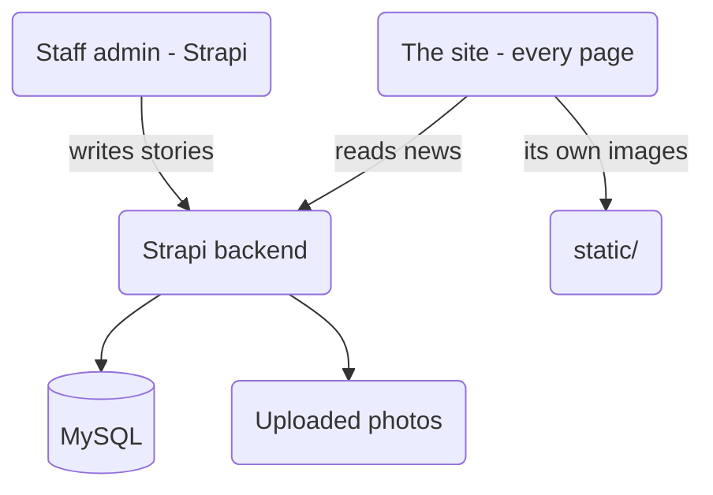

# SOFTNET Information Technology Center — website

One website, one process, one place for the news.

| Folder | What it is |
|---|---|
| `app/` + `nuxt.config.ts` | **Everything a visitor sees** — home, about, contact and news |
| `static/` | The site's own images (`_sitc/images/…`) |
| `frontend.md` | A reference for how the site **looks** — read it before changing any styling |
| `migrations/`, `database.sql` | The **old PHP database** — kept as a record only, nothing reads them |

The news and the admin live in a **Strapi** backend, in its own folder outside this project
(`Documents\strapi`).

### Who owns what



- **The site is one program.** Nuxt answers every address, including the news pages, and it is
  the only thing a visitor ever talks to.
- **The news is data, not pages.** Strapi answers `/api/news`; the site reads it. A story posted
  a minute ago is on the site immediately — nothing is rebuilt or uploaded.
- **The admin is Strapi's own.** There are no admin screens inside this project.
- **Nothing here is PHP.** The old PHP backend has been deleted.

---

## 1. Running it on this PC

Two programs, in this order:

```powershell
# 1. the database (Laragon → Start All, so MySQL is running)

# 2. the news backend
cd 'C:\yourpath\your-strapi-project'
npm run develop            # the admin is then at http://localhost:1337/admin

# 3. this site
cd 'C:\yourpath\your-project'
npm install
npm run dev                # http://localhost:3000
```

To run the finished thing the way a host does:

```powershell
npm run build              # writes .output/server and .output/public
npm start                  # node .output/server/index.mjs  → http://localhost:3000
```

`npm run dev` is for working on the site; `npm start` is what a host runs. There is **no
`index.html`** and none is needed — the server draws every page, so `/`, `/news` and
`/news/<slug>` all work from the running process.

### The news backend must be running

Every news page asks Strapi for its story on the server. If Strapi is not running, those pages
say plainly that the news service could not be reached and answer **503** — they never pretend
the story does not exist. The home page quietly hides its news section and logs why.

---

## 2. How a news page works

This is the part worth understanding, because it is why the site needs Node at all.

**Facebook, Messenger, WhatsApp and Google do not run JavaScript.** They read the HTML the
server sends and build the preview card from the tags in `<head>`. A story's real title and
cover photo live in a database, so they have to be written into the page *before* it leaves the
server.

That used to be done by one PHP file, and it was the only reason PHP was still on the site. Now
the page is built by the server on every request, so **`app/pages/news/[slug].vue` writes those
tags itself** — and nothing else is needed.

- **the visitor gets a real story, in the site's own design**, drawn from the news API;
- **a crawler or a chat app gets the real title, summary and photo** in the HTML itself;
- **nothing is baked into a file**, so a story corrected in the admin shows the correction on
  the next visit.

The list works the same way: `/news` and `/news/page/2` are read from the news API **on the
server** (`app/components/NewsBrowser.vue`), so Google and a reader with JavaScript switched off
see a real list of stories rather than an empty shell.

`/about` and `/contact` are the only pages written to files at build time (`nitro.prerender` in
`nuxt.config.ts`) — their text never changes. The home page is deliberately **not** in that list:
it shows the latest news.

### Addresses

| Address | What it is |
|---|---|
| `/news` | The list: lead story, grid, tag filter, search, paging |
| `/news/page/2` | Page 2 — a real address of its own, with its own canonical link |
| `/news/sports-day` | One story: cover photo, tags, body, photo gallery, share row |
| `/news/12` | The **old** numeric address — still opens the right story |

---

## 3. The news data (`app/utils/news-api.ts`)

The pages were written when the old PHP backend answered them in one particular shape: a list
with `news`, `total`, `pages` and a ready-made tag row; a story with `date_formatted`, `content`
as HTML and a `gallery`. Strapi speaks a different language — `data`, `meta.pagination`, blocks,
media objects.

**That translation lives in one file.** Every page still reads the old shape, so no page had to
learn a second one — and this file is the only place that knows Strapi exists.

It also decides what a failure *is*:

- **no such story** → the page answers **404**, says so, and is marked `noindex`;
- **the news API is unreachable or unset** → the page answers **503** and says so;
- **there is no news yet** → a normal empty page.

The difference matters: a broken backend must never be published to Google as “this page does
not exist”, and it must never make a visitor think the school has posted nothing.

### The story body

Strapi's editor stores a story as text, and `app/utils/news-api.ts` turns it into HTML and
**escapes every piece of text as it does**, so a story can never bring a script into the page.
That escaping is what makes `v-html` safe in `[slug].vue`.

Pictures inside a story body are made **absolute against the news host**, because that HTML is
printed exactly as it is — nothing is left to add the host afterwards, and the uploads live on
the news host, not here.

### Slow-answering backend: retries

`app/utils/news-fetch.ts` retries every news request, and after that asks the same file over
plain `http` (measurements on the old host showed https hanging on one try in six while http
answered every time). **On the server the patience is shorter** — two tries at five seconds —
because a page is now rendered when it is asked for, and a reader should not be held at a blank
tab by a backend that is really down. In the browser the longer patience is kept.

If every try fails, the failure is reported. Nothing is ever invented to fill a gap.

---

## 4. Two settings, one place

```powershell
# local, in .env
NUXT_PUBLIC_NEWS_API_URL=http://localhost:1337   # where the news is read from
NUXT_PUBLIC_SITE_URL=http://localhost:3000       # where THIS site answers
```

Both are read through `app/composables/useNewsApi.ts`, so the home page section, the news list
and the story page can never disagree about which host holds the news.

They are **two different things and must not be confused**:

| Setting | What it is | What breaks if it is wrong |
|---|---|---|
| `NUXT_PUBLIC_NEWS_API_URL` | the Strapi backend | no news at all; every news page answers 503 |
| `NUXT_PUBLIC_SITE_URL` | where the site answers | every shared story and every canonical link points at the wrong address |

`NUXT_SITE_URL` / `NUXT_NEWS_API` (without `NUXT_PUBLIC_`) also work — they are read when the
site is **built**, and are baked in. On a host prefer the `NUXT_PUBLIC_` pair: those are read
when it **runs**, so changing an address needs a restart, not a new build.

`app/utils/site.js` holds a fallback for both, and the news one is **deliberately empty** — an
empty value makes the news pages say they are not configured, while a wrong one would quietly
show nothing, or point a live site at somebody's laptop.

---

## 5. Putting it on a host

What the site needs: **Node 20 or newer**, and nothing else.

The build output is a **web service**, not a folder of files:

```bash
npm ci
npm run build
NUXT_PUBLIC_NEWS_API_URL="https://news.example" NUXT_PUBLIC_SITE_URL="https://example.com" npm start
```

`npm start` runs `node .output/server/index.mjs`. That is why no `index.html` is needed: the
process answers every address, including `/news`, which a plain file host cannot do.

It listens on port 3000 by default; `PORT` or `NUXT_PORT` changes that.

**On the host:**

1. **Build command** `npm ci && npm run build`; **start command** `npm start`. This is what Render
   runs for the site (`https://softnet-2ypz.onrender.com` is the news backend, a separate
   service).
2. **Set both `NUXT_PUBLIC_` settings** in the host's environment — never in a committed file.
3. **Point Strapi at a public address too.** A site on the internet cannot read news from a
   laptop, and Strapi needs MySQL it can reach.
4. If the host sits behind a proxy, keep the `Host` and `X-Forwarded-Proto` headers through to
   the app: it needs the address the **reader** used, because that address goes into every share
   card.

⚠️ **The live site has not moved.** `sitci.x10.mx` still runs the old PHP upload, which is no
longer in this project. Moving the domain is the last step, and it cannot be undone in a minute.

---

## 6. Security notes (for whoever maintains this next)

- **The story body is escaped where it is turned into HTML** (`blocksToHtml` in
  `app/utils/news-api.ts`). A story's text is never trusted: the block types are a fixed list,
  every piece of text is escaped, and only real `http(s)` addresses become links. At the moment
  the ready-made HTML reaches `v-html`, that escaping is the only thing standing between a story
  and a script running for every visitor.
- **The news API is read, never trusted.** A reply that is not the shape expected produces an
  empty list or a stated failure, never HTML of its own.
- **Failures are stated, never faked.** 404 for a story that is not there, 503 when the news
  backend cannot be answered, and never a page that quietly shows nothing.
- **No secrets in this project.** Strapi's database password lives in the Strapi folder's own
  `.env`, and the site holds no credentials at all. `.env` and `.output/` are in `.gitignore`.
- **Strapi's public role must stay read-only** — find and findOne on News, nothing more.

---

## 7. Known loose ends

- **Nothing on the live site has changed yet.** This project is ready to move; the domain has
  not moved.
- **`migrations/` and `database.sql` are dead weight.** They describe the old PHP database, no
  code reads them, and they can go once the live site is off PHP.
- **The contact form needs its key.** `app/pages/contact.vue` sends through web3forms and reads
  `config.public.web3formsKey`, which `nuxt.config.ts` currently sets to an empty string and no
  environment name is wired to it — so on a real host the form will fail until that is set.
- **Search and tag filtering only find what the API can filter.** Tag matching is a “contains”
  match, so `Art` also finds `Culinary Arts`.
