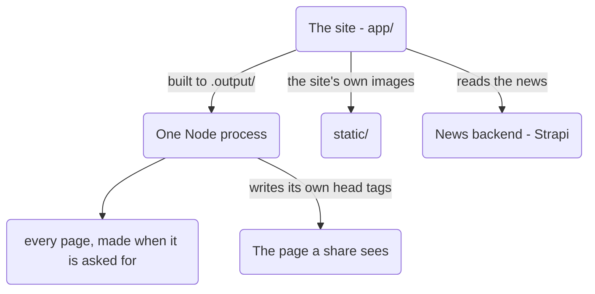

# SOFTNET frontend reference

A map of how the site **looks** and where each look lives. Read this before
changing any styling, so a change lands in the right half of the project.

Written as a reference, not a tutorial. Every value here was read from the
files, so if something disagrees with the code, trust the code and fix this
file.

---

## 1. The big picture

There is **one front end**, served by one Node process.



| Half | Lives in | Served as | Styled by |
|---|---|---|---|
| **Every page a visitor reads** | `app/` | by the Node process, on each request | Tailwind through the Nuxt build |
| **The site's own images** | `static/` | as plain files | — |

**The news pages used to be PHP, then became files in the build, and are now made on the
server.** A story's real title, summary and cover photo have to be in the `<head>` before the
page leaves the server — Facebook and Google read that and never run JavaScript. The page is
now built on every request, so the story is fresh and the share card is right. There is
**one** navbar, **one** footer and **one** Tailwind build.

**One thing that follows:** `nuxt.config.ts` sets `dir.public` to `static/`, so the published
site is `static/` plus the build output and **nothing else**. Uploading is a copy of
`.output/`, which is the whole app — see `README.md`.

**Consequence to remember:** a class you type into a `.vue` file works after
`npm run build`, and never before. There is no second build — the PHP one is gone with the
PHP pages.

---

## 2. Colour

**Two greens live side by side.** The Nuxt site uses bright Tailwind green. The **news
pages** use a deeper green of their own, kept in `news.css`.

The news pages inherited that deep green from the PHP stylesheet (`site.css`). They are Nuxt
pages now, and they keep the same deep green **in their own token block** in
`app/assets/css/news.css` — so the news pages still look like the news pages, while the
rest of the site stays bright green.

| Role | Nuxt site (Tailwind) | News pages (`news.css`) |
|---|---|---|
| Brand | `green-600` `#16a34a` | `--news-brand` `#0e7a4f` |
| Brand, deep | `green-700` `#15803d` | `--news-brand-deep` `#0a5c3c` |
| Brand, pale | `green-50` `#f0fdf4` | `--news-brand-tint` `#e8f5ee` |
| Dark band | `gray-900` `#111827` | — (the hero is Tailwind `bg-gray-900`) |
| Page background | `white` | `--news-page-bg` `#ffffff` under the shared green wash |
| Body text | `gray-600` | `--news-text` `#0f1a14` |
| Muted text | `gray-500` | `--news-muted` `#5b6b61` |
| Hairline | `gray-200` | `--news-border` `#dde5df` |

**Every colour on the news pages lives in one block at the top of
`app/assets/css/news.css`.** Nothing below it should introduce a new hex value — edit
`:root` instead.

The names are prefixed `--news-` on purpose: the same stylesheet is loaded next to
Tailwind, and a bare `--brand` could collide with a Tailwind token of the same name.

`app/assets/css/news.css` is the **only** stylesheet the news pages load. The old PHP
`site.css` went with the PHP backend, so there is no second copy of these colours to keep in
step.

---

## 3. Type, widths and spacing

**Font:** Montserrat, from Google Fonts. It is loaded by `nuxt.config.ts` (which covers
every page a visitor reads) and again by the admin header. There is no local copy and no
fallback file.

| Where | Size |
|---|---|
| Nuxt body | Tailwind base (16px) |
| News story text (`.post-content` in `news.css`) | `17px`, line-height `1.75` |
| News list body (`news.css`) | `17px`, line-height `1.65` |
| News list body, under 600px | `16px` |

### The two width tokens — do not confuse them

| Token | File | Value | Used by |
|---|---|---|---|
| `--news-reading-width` | `app/assets/css/news.css` | `min(90%, 80rem)` | `.article-shell` — the whole of one news item |
| `.container-page` | `app/assets/css/main.css` | `max-w-7xl` + padding | the home, about, contact and news heroes |

Both are **relative** — 90% of the screen capped at 1280px for a story, and a 1280px cap
with side padding for the page shell — which is why the hero band and the story below it
line up on a wide screen.

**The story text has no character cap.** A cap on the paragraphs was removed, because on a
wide screen it left the words visibly narrower than the photos above and below them. If a
line ever feels too long on a big monitor, add the cap back **on the text elements only** —
never on `.article-shell`, or any picture an editor places inside a story gets squeezed to
text width.

**News space steps** (`--news-sp-1` … `--news-sp-8`): `4 · 8 · 12 · 16 · 24 · 32 · 48 · 72`
px. Radii: `--news-radius` 12px, `--news-radius-sm` 8px, `--news-radius-pill` 999px. They
mirror the old `site.css` values exactly, so the news pages did not shift when they moved.

**Nuxt spacing** is plain Tailwind, with two named patterns:

| Class | Means |
|---|---|
| `.section` | `py-14 sm:py-20 lg:py-24` — the standard block padding |
| `.container-page` | `mx-auto w-full max-w-7xl px-5 sm:px-8 lg:px-10` |

Both live in `@layer components` with `@apply`, in `main.css`.

---

## 4. Breakpoints

| Meaning | Value |
|---|---|
| Small phone | under `600px` |
| `sm` | `40rem` / 640px |
| `md` | `48rem` / 768px |
| `lg` | `64rem` / 1024px |
| `xl` | `80rem` / 1280px |
| Reduced motion | `prefers-reduced-motion` |

**Two rules that matter:**

- **Tailwind v4 uses `rem`, not px.** `lg:` compiles to `min-width:64rem`. A
  pixel-based query next to it leaves a sliver of widths where neither rule
  applies. The mobile drawer uses `max-width:63.98rem` for exactly this reason.
- **The gallery pair must stay on the same line.** The grid starts at
  `min-width:640px` and the story page checks `(min-width: 640px)` in JavaScript
  before opening the photo viewer. Same number in both places, so the strip and the
  viewer switch over together.

> **One thing was lost when the news pages left PHP.** The old page had
> `@media not all and (min-width:640px){ .gallery-link{pointer-events:none} }`, which made
> the tap dead on a phone **even with JavaScript off**. That rule was never carried into
> `news.css`. With JavaScript off, tapping a photo on a phone now opens the full-size image —
> the same thing the grid does on a big screen. Add the rule back if you want the old
> behaviour.

---

## 5. The Nuxt site

### Layout

```
app/app.vue              NuxtLayout > NuxtPage
app/layouts/default.vue  AppHeader + <main class="min-w-0 flex-1"> + AppFooter
```

`.texture-bg` is a faint geometric overlay image
(`/_sitc/images/geometric_overlay.jpg` at 480px, `soft-light` blend) over
`#f8faf9`.

**`<main>` swaps its surface by address.** On a news address it carries `.news-page-bg`
(the same faint green wash and dot grid the other pages use, see *Colour*) instead of
`.texture-bg`. The test lives
in `layouts/default.vue`, not in the pages, because `<main>` is what is as tall as the
screen: a page's own markup is only as tall as its content, which would leave the bottom of
a short page plain. The test is the same one the news list uses —
`route.path.startsWith('/news')` — written in both places.

### Pages

| Route | File | Notes |
|---|---|---|
| `/` | `app/pages/index.vue` | Hero, seals, about, programs, facilities, news, CTA |
| `/about` | `app/pages/about.vue` | Hero, history timeline, mission/vision, hymn |
| `/contact` | `app/pages/contact.vue` | Hero, contact cards, form (Web3Forms) + map |
| `/news` | `app/pages/news/index.vue` | Hero band, then `NewsBrowser` |
| `/news/page/2` | `app/pages/news/page/[page].vue` | The same list, one page further on |
| `/news/my-story` | `app/pages/news/[slug].vue` | One story: cover, tags, body, gallery, share |
| anything else | `app/pages/[...slug].vue` | Redirects to `/` |

**Every news address is a live page.** `/news`, `/news/page/2` and `/news/<slug>` are all
rendered by the Node process when they are asked for, and each one writes its own `<head>`
tags. Nothing about the news is written to a file at build time, which is why a story posted a
minute ago is already on the site, and why the paging uses a real address per page
(`/news/page/2`) instead of `/news?page=2`: an address is what can be linked to, shared and
indexed.

Facebook and Google do not run JavaScript, so the title, summary and cover photo are put in the
HTML by the page itself (see `app/pages/news/[slug].vue`) **before** it leaves the server.
Everything else about the page is drawn by the app.

Two statuses are worth knowing, because they are the difference between an honest page and a
misleading one: a story that is not there answers **404** and carries `noindex`, and a news
backend that cannot be reached answers **503** with the list saying so.

**Scroll behaviour** (`app/router.options.ts`): restore the saved position,
else jump to the hash with an 80px offset (clears the fixed navbar), else top.

### Components

| Component | What it draws |
|---|---|
| `AppHeader.vue` | Fixed white navbar. The logo and wordmark **hand over with the home page's cover logo**: the big cover logo shrinks, fades and drifts up, and the navbar group grows up into the bar from its left edge, so the two read as one mark moving up. Both halves read the same numbers from `useCoverShrink` (see below). Any other page — and any visitor with reduced motion — keeps a plain full-size logo, as before. Mobile: slide-in drawer from the right over a blurred backdrop, animated by Vue `<Transition>` |
| `AppFooter.vue` | Dark `gray-900`, `sm:grid-cols-2 lg:grid-cols-4`: brand, Quick Links, Contact, plus a bottom bar |
| `NewsList.vue` | The **Latest News** section on the home page (see below) |
| `NewsBrowser.vue` | The **news list itself** — toolbar, lead card, grid, paging. Shared by `/news` and every `/news/page/N` |
| `TagChips.vue` | Rounded `#tag` chips |
| `SealStrip.vue` | Row of accreditation seals, between the hero and the about block |
| `BackToTop.vue` | Green round button, appears past 480px of scroll. Carried by **Home, About, Contact and all three news pages** — the news pages are the longest, so they need it most. On a story page it is placed **after** the photo viewer `Teleport`, and the viewer's `z-index: 1000` keeps it underneath while a photo is open |

### The news pages

**One hero band serves all three news addresses**, copied class for class from About and
Contact: `bg-gray-900`, `pt-32 pb-16`, a 28px dot texture at `opacity-[0.08]`, two soft
`bg-white/5` circles, and one huge faded word (`NEWS`, or `404` when a story is missing).
The story page adds a `<time>` under the headline, which the other two do not have.

**`news.css` holds every news style.** It was moved out of the PHP `site.css` when the
pages moved, and it is registered in `nuxt.config.ts` **after** `main.css` so the news
tokens win where the two touch.

**The news page surface** is `.news-page-bg`, and it is deliberately the **same surface as
the Home, About and Contact pages**, not a news-only colour. Those pages build it inside
each section: a `bg-gradient-to-b from-green-50/80 via-white to-green-50/80` band, plus a
separate dotted overlay at `opacity-40` (`#22c55e`, 24px grid). `.news-page-bg` folds the
same three parts into one rule, because it is painted on `<main>` and must cover the whole
screen rather than the height of one band:

- `linear-gradient` washing `--news-page-tint` (`green-50` `#f0fdf4` at 80%) down to
  `--news-page-bg` (`#ffffff`) and back — their wash, stretched over the whole page
- `radial-gradient` dots in `--news-page-dot` (`green-500` `#22c55e` at 40% alpha) on a
  24px grid in `--news-page-dot-size`

A dot colour of `green-500` at 40% alpha paints exactly what an `opacity-40` overlay of
opaque dots paints, and it is listed first in `background-image` so the dots paint on top
of the wash — the same order the other pages stack them in. That is what makes the pattern
match theirs dot for dot. All four values are tokens in `news.css` — edit `:root`, never a
hex here. The surface is put on `<main>` by `layouts/default.vue` (see *Layout*).

**`NewsBrowser.vue` is one component shown at many addresses.** That is why the list lives
in a component rather than in a page: `/news` and `/news/page/3` are the same list with a
different page number.

| Piece | Behaviour |
|---|---|
| **Tag row** | A row of buttons with counts, from the `tags` the API reports |
| **Search** | A box on the right. Typing waits **300ms** before asking, so it does not fire on every letter |
| **Lead card** | Only on the plain first page — a search or a tag drops it, so results are not pushed down |
| **Pager** | **Real `NuxtLink`s** while no filter is on, so a crawler can walk the whole list. Once a search or tag is on it becomes buttons, because there is nothing for a crawler to follow |
| **Stale answers** | Each request carries an id, and a slow earlier answer is thrown away rather than overwriting a newer one |

**`[slug].vue` ends in two forms:** a number takes the old `?id=` route, anything else the
`?slug=` one. It also sets the **canonical** link, so Google is told the readable address is
the real home of the story.

**The photo viewer** is a `Teleport` to `body`, so it can cover the page. Escape closes it,
the arrows step through, focus returns to the photo that opened it, and `body.lightbox-open`
stops the page behind from scrolling. On a phone the viewer does not open at all — the swipe
strip is the viewer there.

### The page patterns

**The dark hero band** — used by About, Contact, and (copied) both news pages:

- `bg-gray-900` with `pt-32 pb-16` (the 128px clears the fixed navbar: 80px
  navbar + 48px breathing room)
- dotted texture at `opacity-[0.08]`, 28px grid
- two soft `bg-white/5` circles bleeding off the corners
- one huge faded word (`text-[10vw] font-black text-white/5`): `ABOUT`,
  `CONTACT`, `NEWS`, `404`
- inside: a green-300 eyebrow, then the headline, then a description

**The green content band** — the home page's own sections:

- `bg-gradient-to-b from-green-50/80 via-white to-green-50/80`
- a 24px green dot texture at `opacity-40`
- a centred `max-w-2xl` heading

The facilities section is the exception: `bg-green-50/60` with the same dots.

**`.card`** — white, `rounded-2xl`, `ring-1 ring-gray-200`, lifts 1.5px and
rings green on hover.

**Buttons:** `.btn-primary` (filled green pill), `.btn-outline` (white outline
for dark backgrounds).

### The Latest News section

This is the home page's own section — `NewsList.vue` — and it is **not** the same thing as
the news list page. It shows the newest four stories only.

- Background `.news-bg`: `#f0fdf4` plus two soft green radial glows, under a
  hairline `border-t border-green-100` — the facilities section above is also
  pale green, so the line is what keeps them from merging.
- **Left-aligned header** with "View all news" on the right, deliberately not
  centred, so it does not repeat the centred heading above it.
- **Lead story:** image beside text (`lg:grid-cols-[1.05fr_1fr]`), image
  `object-contain`, `max-h-[420px] min-h-[220px]`.
- **The next three:** `sm:grid-cols-2 lg:grid-cols-3`, images
  `h-48 object-contain`.
- **The whole section is skipped** when there is no news, when the API is
  unreachable, or when no row has a title. Nothing is rendered at all — no
  heading, no empty grid, no gap.

**It fetches on the server**, inside `useAsyncData`, so the stories arrive with the page:
Google and a reader without JavaScript see the headlines themselves rather than a space that
fills in later.

**Its links stay on this site.** "View all news" and the tag chips point at `/news` — they
used to be absolute links built from the news host (`newsIndexUrl`), which was the same domain
while PHP served the news pages, but would now drop a reader on the news backend where there is
no page to land on.

### Motion

| Effect | Where |
|---|---|
| `marquee` keyframes, 32s, pauses on hover | `.marquee-track` |
| `rainbow-shift`, 4s | `.rainbow-text` — the `#WhereFunAndLearningConnect!` line |
| Parallax (`background-attachment: fixed`) | `.parallax-fixed`, only at `width >= 1024px` with `hover: hover` and `pointer: fine` |
| Drag-to-scroll with inertia | Facilities row, in `index.vue` |

### Reduced motion

**One place handles this now, and it has a gap:**

- **Nuxt (`main.css`)** names only three things now (it used to also set
  `scroll-behavior: smooth` on `<html>`, which was removed): `scroll-behavior:
  auto`, `.marquee-track`, and `.parallax-fixed`. **`.rainbow-text` keeps animating,
  and the drag-to-scroll inertia in `index.vue` keeps running.** If that matters
  to you, the fix is to add `.rainbow-text{animation:none}` to the existing
  `prefers-reduced-motion` block in `main.css`.
- **Explicit JS scrolls ignore that block:** `scroll-behavior: auto` in CSS does
  not cancel a call that passes `behavior: 'smooth'` by hand. The three that do
  (the `/#section` links, `BackToTop.vue`, the facilities arrows) animate even
  for a visitor who asked for reduced motion. Wrap them in a
  `matchMedia('(prefers-reduced-motion: reduce)')` check if that needs fixing.
- **`news.css` has its own block** at the bottom that switches off the news-card lift and
  the gallery hover, so the news pages do respect the setting.

### Two scrolling patterns worth knowing

- **Facilities row:** `.facility-scroll` is a horizontal scroll with the
  scrollbar hidden, plus pointer-drag with momentum. Cards are fixed at 280×280
  (`.facility-card`) so they never squeeze.
- **Photo strip (news pages):** plain CSS scroll-snap, in `news.css`. See section 7.

---

## 6. There is no PHP any more

This section used to be long. It described keeping **two copies** of the navbar and the footer
in step — one in Vue, one in PHP — and the second Tailwind build that made the PHP copy work.

**The whole PHP side has since been deleted**, not just retired: the folder that held it, the
API, the admin screens, the hand-copied navbar and footer, `site-info.php`, the second Tailwind
build (`npm run build:php-css`) and the checks that inspected them.

What that leaves for anyone reading this file:

- **One navbar, one footer, one build.** `AppHeader.vue` and `AppFooter.vue` are the only
  copies, and `npm run build` is the only build.
- **One copy of the school's details** — `app/utils/site.js` holds the address, the phone
  numbers, the email and the hours.
- **The admin panel is Strapi now.** It has its own look, its own address, and none of it is
  styled from `news.css`.

**The project is a git repository**, so anything deleted is still in its history if it is ever
wanted back.

---

## 7. The photo gallery

The sub images are drawn by `app/pages/news/[slug].vue` — **one** block of markup serves
both phone and desktop, and the width of the screen decides which one you see.

| Screen | What it is |
|---|---|
| under 640px | A **sideways strip**: one photo fills the width, scroll-snap, flick to the next. Dots + a "2 of 5" counter below. Tapping does nothing — the strip is the viewer. |
| 640px and up | A **grid** (`auto-fill, minmax(200px, 1fr)`). Clicking opens the viewer. |

The switch is a single `min-width:640px` query in `news.css`, and the story page checks the
**same 640px** in JavaScript before opening the viewer. Same number, two places — keep them
in step.

**Photos use `object-fit: contain`** — the whole picture, never a cropped middle. `cover` was
used once and cut the edges off.

**No heading and no photo count** above the grid. The pictures speak.

**The viewer** is Vue, not a script:

| Piece | How it works |
|---|---|
| Opening | `openViewer(i)` remembers the photo that was clicked, so focus can go back to it |
| Closing | Escape, the close button, or a tap on the backdrop |
| Stepping | Arrow keys, or the on-screen arrows. It **wraps** at both ends |
| Behind the page | `body.lightbox-open` stops the page scrolling while it is open |
| Covering the page | `<Teleport to="body">`, so no parent's `overflow` can clip it |
| On a phone | `openFromClick()` does nothing under 640px |

**With JavaScript off** the grid links still open the full-size image — every photo keeps a
real `href`.

**The cover photo is capped separately** from the gallery: never wider than 520px and never
taller than `min(52vh, 440px)`, `object-contain`. The `.article-column img.post-image`
selector is deliberately more specific than `.article-column img`, or the cap would be
ignored.

---

## 8. Traps to keep in mind

| Trap | Why it bites | What protects you |
|---|---|---|
| The news pages are made on the server | That is the design: each is rendered when it is asked for, so its share card is right | The app writes the head tags itself; `news-view.php` is not involved any more |
| An old upload left in the way | Frozen pages from an older build would sit there unread | The build writes no `news/` folder at all; delete one if you see it |
| Every readable news address is a page | Nuxt routes them | `app/pages/news/index.vue`, `page/[page].vue` and `[slug].vue` |
| A story exists at two addresses | `/news/12` and `/news/sports-day` both work | The number is matched against the old id and Strapi's own, and the page carries a **canonical** |
| A story that is not there | Google would keep a dead address alive | The page answers **404** and sets `noindex` |
| The news backend being down | A reader must not be told the school posted nothing | The pages answer **503** and say the news service could not be reached |
| A picture inside a story body | That HTML is printed as it is — nothing can add the host afterwards | `news-api.ts` makes body pictures absolute against the **news** host |
| The gallery pair must stay on one line | A tap that opens the viewer on a phone fights the swipe strip | `640px` written in `news.css` **and** in `[slug].vue` |
| `<ul>` bullets in the footer | No Tailwind reset once meant the browser's own bullet applied | `list-none` on both lists, so both halves read the same |
| A pixel breakpoint next to a `rem` one | Tailwind v4 emits `rem` | Match the unit; the drawer uses `63.98rem` |
| Tag chips rendering as broken tags | Naming a component in a variable renders its NAME, not a link | `TagChips.vue` writes the two elements out instead of choosing one dynamically |
| Raw story text | A story could bring a script into the page | `blocksToHtml()` escapes every piece of text and allows only a fixed list of blocks — that is what makes `v-html` safe |
| A share card with the wrong photo | Facebook reads `<head>` only, and never runs JavaScript | The story page writes `og:title` and `og:image` from the news API on every request |

---

## 9. File map

| Path | What it is |
|---|---|
| `app/assets/css/main.css` | All Nuxt styling for the whole site: tokens, `.container-page`, `.section`, `.card`, buttons, textures, motion |
| `app/assets/css/news.css` | **All news styling** — tokens, cards, the article shell, the gallery, the viewer, the pager, the toolbar |
| `app/components/AppHeader.vue` | Navbar + mobile drawer |
| `app/components/AppFooter.vue` | Footer |
| `app/components/NewsList.vue` | The **Latest News** section on the home page |
| `app/components/NewsBrowser.vue` | The **news list** — toolbar, lead card, grid, paging. Used by `/news` and `/news/page/N` |
| `app/components/TagChips.vue`, `SealStrip.vue`, `BackToTop.vue` | Small pieces |
| `app/pages/news/index.vue` | `/news` — hero band, then the list |
| `app/pages/news/page/[page].vue` | `/news/page/2`, `/news/page/3`, … |
| `app/pages/news/[slug].vue` | One story: cover, tags, body, gallery, viewer, share |
| `app/composables/useNewsApi.ts` | **One place** that answers "where is the news, and where is this site" |
| `app/composables/useNewsListHead.ts` | The `<head>` of the news list: title and canonical per page |
| `app/utils/news-api.ts` | The one file that knows Strapi exists: asks it, escapes the story, answers in the shape the pages use |
| `app/utils/news-fetch.ts` | Retries a slow news backend; shorter patience on the server |
| `app/utils/site.js` | Address, phones, email, hours — the only copy now |
| `static/_sitc/images/` | The site's own images. Published with the site |
| `nuxt.config.ts` | Every setting: the two hosts, the design tokens' stylesheets, and the pages written to files at build time |
| `README.md` | How the site is put together — the overview |
| `frontend.md` | This file: how it looks and where each look lives |

---

## 10. If you want to change X

| Goal | Edit | Then |
|---|---|---|
| A colour on the news pages | `:root` in `app/assets/css/news.css` | `npm run build` |
| A colour on the rest of the site | `:root` / `@theme` in `app/assets/css/main.css` | `npm run build` |
| The navbar or footer look | `AppHeader.vue` / `AppFooter.vue` — **the only copies** | `npm run build` |
| A phone number or address | `app/utils/site.js` — **the only copy** | `npm run build` |
| The hero band | About/Contact first, then the three news pages to match | `npm run build` |
| The width of one news item | `--news-reading-width` in `news.css` | `npm run build` |
| The gallery breakpoint | **Both** `news.css` and `[slug].vue` — they must agree | `npm run build` |
| The news list, paging or search | `app/components/NewsBrowser.vue` | `npm run build` |
| A new page on the site | `app/pages/` | `npm run build` |
| The news backend's address | `NUXT_PUBLIC_NEWS_API_URL` (`.env` locally, the host's settings in production) | restart, no rebuild |

---

## 11. Commands

```bash
npm run dev      # the site locally at http://localhost:3000
npm run build    # builds the site into .output/ — no internet needed
npm run preview  # serves the built site
npm start        # serves the built site the way a host does (Node, port 3000)
```

**`npm run generate` is gone.** The site is not a folder of finished files any more: the news
pages are made when they are asked for, so that a story's real title and cover photo can be
written into the page for Facebook and Google. There is nothing for `generate` to write.

**There is no second build.** `npm run build:php-css` and its watch version were removed with
the PHP news pages.

**`npm start` is the one a host runs.** It starts the built server in `.output/server/`, and
that server answers every address itself — which is why a host needs no `index.html` for
`/news`, `/news/<slug>` or the home page.

**There are no PHP checks any more.** They tested the deleted PHP backend.

---

## 12. Known loose ends

- **A tag chip on a story page now filters.** `NewsBrowser.vue` reads `route.query.tag` and
  opens the list with that tag already on, so `/news?tag=sports` shows only that tag. (The
  chips on a story page used to land on the unfiltered list.)
- **The news lives on Render now.** `.env` points the site at
  `https://softnet-2ypz.onrender.com/`, so the site no longer needs the Strapi copy on this PC.
  The live x10hosting domain is still on the old PHP upload; moving it is the last step.
- **The phone gallery lost its no-JavaScript rule.** See section 4 — tapping a photo on a
  phone with JavaScript off now opens the full-size image.
- **The two greens are still different** (`#16a34a` for the site, `#0e7a4f` for the news
  pages). Intentional and now in two separate files, so a change to one does not touch the
  other — but it does mean the home page and the news list do not match exactly side by side.
- **The reduced-motion block is incomplete.** `main.css` covers scrolling, the marquee and
  the parallax, but **not** `.rainbow-text` and **not** the facilities drag-to-scroll. One line
  in `main.css` closes it. `news.css` has its own block and is fine.
- **The contact form has no key on a host.** `contact.vue` posts to Web3Forms with
  `config.public.web3formsKey`, and `nuxt.config.ts` leaves it empty with no environment name
  wired to it. Set it there before the form is expected to work on a live site.
- **The news pages have never been looked at on a screen** while checking them: they were
  verified by running the built site against a stand-in news feed and reading the HTML that came
  back — status codes, share tags, the story body, the links.
